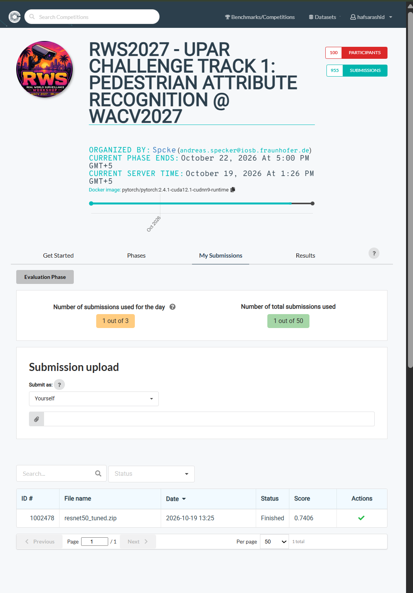

# CV Assignment 2: UPAR Challenge 2027, Track 1 (Pedestrian Attribute Recognition)

**Hafsa Rashid (23K-0064), Syeda Sara Ali (23K-0070)**
FAST NUCES Karachi, Computer Vision (AI-4002)

Challenge: https://www.codabench.org/competitions/18180/

## Task
Given a cropped image of a person from a surveillance camera, predict 40 yes/no attributes
(age group, gender, hair, upper/lower body clothes and colors, bag, backpack, glasses, hat).
Images come from different datasets (Market1501, PA100k, PETA), so the model has to handle domain shift.

## Our approach
- Backbone: ResNet50 (ImageNet pretrained, torchvision), last layer replaced with Dropout + Linear(2048 -> 40)
- Input size 256 x 128
- Loss: BCE with higher weight for rare attributes + masking of missing labels + small label smoothing
- Augmentations: flip, color jitter, random erasing (light set, Colab has only 2 CPU cores)
- AdamW (lr 3e-4) + OneCycle LR, batch 64, mixed precision, EMA of weights
- Trained by us for 3 epochs on a Google Colab T4 GPU (about 7 min per epoch, 21 min total) with `colab_train.ipynb`
- Flip TTA at test time + per attribute threshold tuning on the validation set

## Folder structure
```
CV A2 UPAR/
  config.py            all settings and paths
  dataset.py           annotation loading, dataset class, augmentations
  model.py             model + loss
  metrics.py           challenge metrics (mA, F1, score) + threshold search
  train.py             training script (supports --resume)
  colab_train.ipynb    colab notebook: download data, train resnet50, make submission
  evaluate.py          makes all tables and graphs in results/
  test_model.py        runs the trained model on sample images
  make_submission.py   builds the codabench zip
  check_submission.py  tests the zip locally before upload
  requirements.txt
  submission_code/     run.py + metadata.yaml that go inside the zip
  data/                official val labels (val_gt.csv) + attribute prior
  results/             csv tables, figures, training log (log.json, final.json)
  sample_images/       pedestrian images for quick testing
  docs/                report.pdf, presentation.pptx, codabench_submission_proof.png
  submission_proof/    official codabench submission screenshot
  runs/resnet50/       our colab run: best.pt, thresholds.json, val_probs.npy (not in the repo)
```

## How to run
```bash
pip install -r requirements.txt
```

**On Colab:** open `colab_train.ipynb` and run all cells. It downloads the data, trains ResNet50,
evaluates it and builds the submission zip. Everything is saved in `runs/resnet50/` on Drive.

**Locally** (after copying `runs/resnet50/` from Drive):
```bash
python evaluate.py                 # tables + graphs in results/
python test_model.py               # predictions on sample_images/
python make_submission.py          # makes runs/resnet50/resnet50_tuned.zip
python check_submission.py         # tests that zip
```

**Training** (needs a GPU + the UPAR images):
```bash
python train.py --train_csv <train gt.csv> --val_csv <val gt.csv> --img_root <data folder> \
    --backbone resnet50 --epochs 3 --bs 64 --lr 3e-4 --light_aug --out runs/resnet50
```
Dataset images: clone https://github.com/speckean/UPAR-Challenge-2027 and run its `download_datasets.py`.

## Results
Validation set (33,407 images):

| Method | Market1501 | PA100k | PETA | Mean score |
|---|---|---|---|---|
| Prior baseline | 58.17 | 53.28 | 51.40 | 54.28 |
| ResNet50 @ 0.5 | 86.46 | 84.24 | 86.08 | 85.59 |
| ResNet50 + tuned thresholds | 87.10 | 85.72 | 86.93 | **86.58** |

Score = harmonic mean of mA and instance F1, computed per dataset and then averaged.
Threshold tuning checked on held out halves of val: +0.83 and +0.90 gain, so it is not only overfitting.

**Codabench hidden test score: 0.7406** (submission ID 1002478, 19 Oct 2026)

## Official Codabench submission
- Track 1, Evaluation Phase
- Submission ID: 1002478 (resnet50_tuned.zip), 19 Oct 2026
- Status: Finished
- Hidden test score: 0.7406



## Validation vs test
Our validation score is 86.58 but the hidden test score is 74.06, a drop of about 12.5 points.
The validation images come from the same datasets and cameras as the training images,
while the hidden test set has images from other cameras and scenes. This domain shift
(different lighting, resolution, viewpoints and clothing styles) is the main reason for the gap.
The thresholds were also tuned on val, so they fit the val data better than the test data.

## Main challenges
- 20 of 40 attributes have less than 5% positive images, sunglasses is the worst (mA 63.9)
- Accessories (mA 79.2) and lower body colors (F1 51.1) are the weakest groups
- Domain shift between datasets (PA100k is the hardest on val, 85.72) and to the hidden test set
- Low resolution and occlusion in surveillance crops
- Limited Colab time, so we could only train for 3 epochs

## Notes
- Model weights (best.pt) are not in the repo because of size; put them in runs/resnet50/ to run evaluation or rebuild the submission.
- Future work: train for more epochs, use a stronger backbone such as ConvNeXt, and use stronger augmentation for domain shift.
